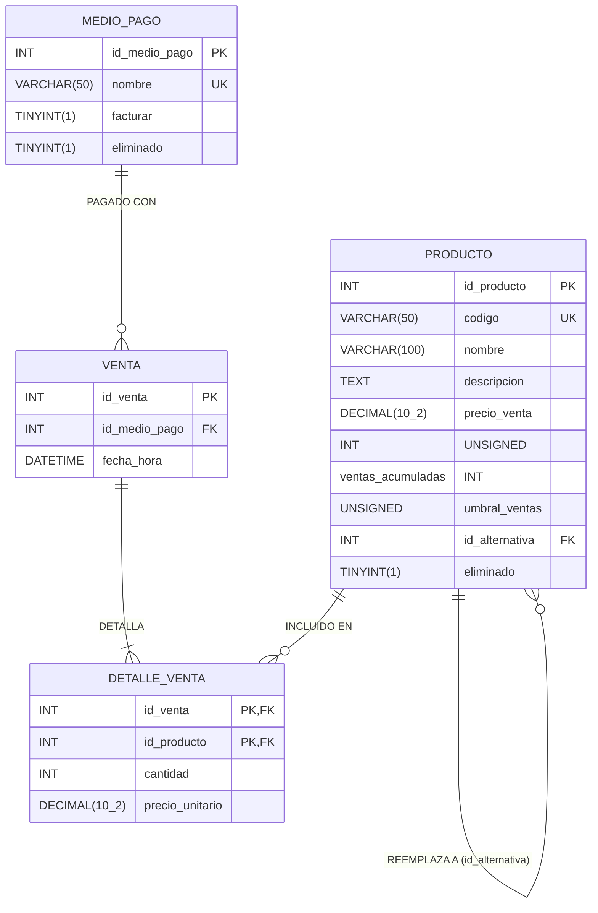

# 📚 Sistema de Gestión de Librería

Aplicación de escritorio desarrollada en **Python (Tkinter)** con persistencia en **MySQL** para la administración integral del inventario, punto de venta (POS), reportes estadísticos en Excel y facturación electrónica integrada con **ARCA / AFIP** (Argentina).

---

## 📋 Tabla de Contenidos

- [Características Principales](#-características-principales)
- [Tecnologías y Dependencias](#-tecnologías-y-dependencias)
- [Arquitectura y Estructura del Proyecto](#-arquitectura-y-estructura-del-proyecto)
- [Modelo de Base de Datos](#-modelo-de-base-de-datos)
- [Requisitos Previos](#-requisitos-previos)
- [Instalación y Configuración](#-instalación-y-configuración)
  - [1. Clonar el repositorio](#1-clonar-el-repositorio)
  - [2. Instalar dependencias](#2-instalar-dependencias)
  - [3. Configurar la base de datos MySQL](#3-configurar-la-base-de-datos-mysql)
  - [4. Crear el archivo `config.ini`](#4-crear-el-archivo-configini)
- [Uso de la Aplicación](#-uso-de-la-aplicación)
- [Facturación Electrónica (ARCA / AFIP)](#-facturación-electrónica-arca--afip)
- [Generación de Ejecutable (`.exe`)](#-generación-de-ejecutable-exe)
- [Respaldos Automáticos](#-respaldos-automáticos)

---

## ✨ Características Principales

### 1. Gestión de Productos (`Pestaña Productos`)
- **ABM Completo (Alta, Baja lógica y Modificación):** Administración de código único, nombre, precio de venta, descripción (hasta 300 caracteres con contador en tiempo real) y producto alternativo de reemplazo.
- **Productos Alternativos:** Asociación de un producto sustituto (`id_alternativa`) con buscador modal integrado y visualización rápida desde las pestañas de Productos y Ventas.
- **Umbral Objetivo y Alertas de Ventas:** Seguimiento de `ventas_acumuladas` frente a un `umbral_ventas` configurable por artículo. Los productos que alcanzan o superan su umbral se destacan automáticamente en el panel **Stock en alerta**, permitiendo reiniciar su contador acumulado.
- **Búsqueda Combinada y Ordenamiento Dinámico:** Filtrado por código, nombre o descripción y ordenamiento ascendente/descendente en todas las tablas (numérico, cronológico y alfabético).

### 2. Punto de Venta y Carrito (`Pestaña Ventas`)
- **Carrito de Compras Interactivo:** Agregado rápido por código y cantidad, cálculo automático de subtotales y total general, consulta rápida de precios y productos alternativos.
- **Ventana Modal de Cobro (`VentanaCobro`):** Selección de medio de pago y cálculo automático de vuelto para pagos en efectivo.
- **Historial y Buscador de Ventas:** Visualización de ventas históricas, búsqueda puntual por ID de venta, inspección del detalle de cada venta en el carrito y anulación de ventas (con opción de revertir o conservar las ventas acumuladas de los artículos involucrados).
- **Exportación de Reportes a Excel (`.xlsx`):**
  - **Reporte de Ventas:** Detalle cronológico de ventas con productos, cantidades, precios unitarios, subtotales y totales por operación, con formato y bordes automáticos.
  - **Reporte / Ranking de Productos:** Ranking de productos activos ordenados por recaudación total y unidades vendidas.

### 3. Administración y Configuración (`Pestaña Ajustes`)
- **Gestión de Medios de Pago:** Creación, edición, borrado lógico (individual o masivo) y restauración automática de medios de pago, con indicador individual de **Facturar** (`Sí / No`) para determinar si la venta emite comprobante electrónico ante ARCA/AFIP.
- **Configuración de Facturación AFIP/ARCA:** Configuración visual de CUIT emisor, Punto de Venta, rutas a Certificado (`.crt`) y Clave Privada (`.key`), modo Homologación/Producción y generador integrado de Clave Privada RSA 2048 bits + Solicitud de Certificado (`.csr`).

---

## 🛠 Tecnologías y Dependencias

| Componente | Tecnología / Librería | Propósito |
| :--- | :--- | :--- |
| **Lenguaje** | Python 3.12+ | Lógica principal de la aplicación |
| **Interfaz Gráfica** | `tkinter` / `ttk` | GUI de escritorio con tema personalizado (`clam`) |
| **Base de Datos** | MySQL 8.0 (`mysql-connector-python`) | Persistencia relacional con manejo de transacciones y reintentos ante *deadlocks* |
| **Facturación Electrónica** | `zeep`, `requests`, `urllib3`, `lxml`, `pytz`, `python-dateutil` | Consumo de Web Services SOAP de ARCA/AFIP (`WSAA` y `WSFEv1`) |
| **Criptografía** | `cryptography` | Generación de claves RSA, solicitudes X.509 CSR y firma PKCS#7 (CMS) para tickets de acceso |
| **Reportes** | `pandas`, `openpyxl` | Generación y estilizado de reportes en formato Excel (`.xlsx`) |
| **Empaquetado** | `pyinstaller` | Compilación en un único ejecutable `.exe` para Windows |

---

## 📂 Arquitectura y Estructura del Proyecto

```text
Libreria/
├── Programa.py                        # Punto de entrada y controlador principal de la interfaz gráfica (clase Aplicación)
├── base_de_datos.py                   # Capa de acceso a datos (DAO) en MySQL y respaldos con mysqldump
├── facturación.py                     # Emisión de Factura Electrónica B (Consumidor Final) vía WSFEv1
├── funciones_útiles.py                # Validaciones de UI, lectura/escritura de config.ini y rutinas de respaldo
├── validación_tipo_de_datos.py        # Funciones auxiliares de validación de tipos (enteros y decimales)
├── VentanaCobro.py                    # Modal para seleccionar medio de pago, calcular vuelto y confirmar venta
├── MensajeModerno.py                  # Modal personalizado para alertas, confirmaciones, errores y notificaciones
├── MensajeEntrada.py                  # Modal personalizado para captura de texto (ej. Razón Social para CSR)
├── VentanaCierre.py                   # Modal con barra de progreso indeterminada para operaciones en segundo plano
├── generar_csr.py                     # Script independiente por consola para generar clave privada (.key) y CSR (.csr)
├── Generar ejecutable.py              # Script de automatización para empaquetar la app con PyInstaller
├── Sistema gestión de librería.spec   # Especificación de compilación de PyInstaller
├── Consultas a la base de datos.sql   # Script SQL con estructura inicial y datos de prueba
├── MER.drawio                         # Diagrama Entidad-Relación (editable en draw.io / diagrams.net)
├── librería.ico                       # Ícono de la aplicación
└── arca_arg/                          # Paquete de integración con Web Services de ARCA / AFIP
    ├── __init__.py
    ├── auth.py                        # Autenticación WSAA (generación de TRA, firma PKCS#7 y caché de LoginTicket .pkl)
    ├── settings.py                    # Endpoints WSDL de homologación y producción y parámetros globales
    └── webservice.py                  # Cliente SOAP genérico (ArcaWebService) basado en Zeep
```

---

## 🗄 Modelo de Base de Datos

El diagrama conceptual completo se encuentra en `MER.drawio`. El sistema utiliza la base de datos `tienda_db` con cuatro tablas principales:



---

## ⚙️ Requisitos Previos

- **Sistema Operativo:** Windows 10 / 11 (recomendado por integración con `mysqldump.exe` e íconos `.ico`) o Linux/macOS para desarrollo.
- **Python:** `3.12` o superior (con soporte para `tkinter`).
- **Servidor de Base de Datos:** MySQL Server `8.0` o superior.

---

## 🚀 Instalación y Configuración

### 1. Clonar el repositorio

```bash
git clone https://github.com/Gabriel1610/Libreria.git
cd Libreria
```

### 2. Instalar dependencias

Se recomienda crear un entorno virtual antes de instalar los paquetes:

```bash
python -m venv venv
# En Windows:
venv\Scripts\activate
# En Linux/macOS:
source venv/bin/activate

pip install mysql-connector-python pandas openpyxl cryptography requests urllib3 zeep lxml pytz python-dateutil babel pyinstaller
```

### 3. Configurar la base de datos MySQL

Ejecutá el siguiente esquema SQL en tu servidor MySQL (actualizado con todas las columnas requeridas por `base_de_datos.py`):

```sql
CREATE DATABASE IF NOT EXISTS tienda_db
CHARACTER SET utf8mb4
COLLATE utf8mb4_unicode_ci;

USE tienda_db;

CREATE TABLE IF NOT EXISTS PRODUCTO (
    id_producto INT AUTO_INCREMENT PRIMARY KEY,
    codigo VARCHAR(50) NOT NULL UNIQUE,
    nombre VARCHAR(100) NOT NULL,
    descripcion TEXT NULL,
    precio_venta DECIMAL(10, 2) NOT NULL,
    ventas_acumuladas INT UNSIGNED NULL DEFAULT 0,
    umbral_ventas INT UNSIGNED NULL DEFAULT NULL,
    id_alternativa INT NULL DEFAULT NULL,
    eliminado TINYINT(1) NOT NULL DEFAULT 0,
    CONSTRAINT fk_producto_alternativa
        FOREIGN KEY (id_alternativa)
        REFERENCES PRODUCTO(id_producto)
        ON DELETE SET NULL
        ON UPDATE CASCADE
) ENGINE=InnoDB;

CREATE TABLE IF NOT EXISTS MEDIO_PAGO (
    id_medio_pago INT AUTO_INCREMENT PRIMARY KEY,
    nombre VARCHAR(50) NOT NULL UNIQUE,
    facturar TINYINT(1) NOT NULL DEFAULT 0,
    eliminado TINYINT(1) NOT NULL DEFAULT 0
) ENGINE=InnoDB;

CREATE TABLE IF NOT EXISTS VENTA (
    id_venta INT AUTO_INCREMENT PRIMARY KEY,
    id_medio_pago INT NOT NULL,
    fecha_hora DATETIME NOT NULL DEFAULT CURRENT_TIMESTAMP,
    CONSTRAINT fk_venta_medio_pago
        FOREIGN KEY (id_medio_pago)
        REFERENCES MEDIO_PAGO(id_medio_pago)
        ON DELETE RESTRICT
        ON UPDATE CASCADE
) ENGINE=InnoDB;

CREATE TABLE IF NOT EXISTS DETALLE_VENTA (
    id_venta INT NOT NULL,
    id_producto INT NOT NULL,
    cantidad INT NOT NULL DEFAULT 1,
    precio_unitario DECIMAL(10, 2) NOT NULL,
    PRIMARY KEY (id_venta, id_producto),
    CONSTRAINT fk_detalle_venta
        FOREIGN KEY (id_venta)
        REFERENCES VENTA(id_venta)
        ON DELETE CASCADE
        ON UPDATE CASCADE,
    CONSTRAINT fk_detalle_producto
        FOREIGN KEY (id_producto)
        REFERENCES PRODUCTO(id_producto)
        ON DELETE RESTRICT
        ON UPDATE CASCADE
) ENGINE=InnoDB;

-- Medios de pago iniciales sugeridos
INSERT IGNORE INTO MEDIO_PAGO (nombre, facturar) VALUES
    ('Efectivo', 0),
    ('Transferencia', 1),
    ('Tarjeta de Débito', 1),
    ('Tarjeta de Crédito', 1);
```

### 4. Crear el archivo `config.ini`

En la raíz del proyecto (o junto al ejecutable `.exe`), creá un archivo llamado `config.ini` con codificación `UTF-8` (excluido en `.gitignore` por seguridad):

```ini
[database]
host = localhost
user = root
password = tu_contraseña_mysql
database = tienda_db

[facturacion]
cuit = 20123456789
punto_venta = 1
certificado = C:/ruta/a/tu/certificado.crt
key = C:/ruta/a/tu/privada_20123456789.key
produccion = False
```

---

## 💻 Uso de la Aplicación

Para iniciar el sistema desde el código fuente:

```bash
python Programa.py
```

### Flujo de trabajo habitual:
1. **Ajustes:** Verificá o cargá los **Medios de pago** (marcando la casilla `Facturar` en aquellos que deban emitir Factura B ante ARCA/AFIP) y completá los datos del panel **Facturación AFIP**.
2. **Productos:** Dá de alta los artículos indicando código, nombre, precio y, opcionalmente, un umbral de ventas (para recibir alertas de reposición/rotación) y un código de producto alternativo.
3. **Ventas:** Ingresá el código del artículo y la cantidad para sumarlo al carrito. Al presionar **Finalizar venta**, seleccioná el medio de pago en la ventana de cobro. Si el medio es *Efectivo*, ingresá el monto recibido para calcular el vuelto automáticamente.

---

## 🧾 Facturación Electrónica (ARCA / AFIP)

El módulo `facturación.py` junto con el paquete `arca_arg` permiten emitir **Facturas B (Código 006)** a **Consumidor Final** con cálculo automático de importe neto e IVA (21%).

### Pasos para obtener el Certificado Digital:
1. En la aplicación, abrí la pestaña **Ajustes** → sección **Facturación AFIP** (o ejecutá `python generar_csr.py` por consola).
2. Ingresá tu **CUIT Emisor** y hacé clic en **Generar Solicitud de Certificado**.
3. Ingresá tu Nombre o Razón Social en la ventana emergente. Se generarán dos archivos en el directorio de la aplicación:
   - `privada_<CUIT>.key`: Clave privada RSA de 2048 bits (se autocompleta en el formulario).
   - `pedido_<CUIT>.csr`: Solicitud de certificado CSR.
4. Ingresá al portal de **ARCA / AFIP** con Clave Fiscal → servicio **Administración de Certificados Digitales** (o *WSASS - Autogestión Certificados Homologación* para pruebas).
5. Subí el archivo `pedido_<CUIT>.csr`, descargá el certificado `.crt` emitido y vinculalo al web service **wsfe** (*Facturación Electrónica*).
6. Seleccioná el archivo `.crt` en la pestaña **Ajustes** y presioná **Guardar Configuración**.

> **Nota técnica:** El sistema incluye un adaptador SSL personalizado (`CifradoFuerteAdapter`) para garantizar la compatibilidad con los niveles de cifrado requeridos por los servidores de ARCA/AFIP y almacena en caché los Tickets de Acceso (`wsfe.pkl`) durante su período de validez (12 horas).

---

## 📦 Generación de Ejecutable (`.exe`)

El proyecto incluye el script `Generar ejecutable.py` que empaqueta la aplicación en un único archivo ejecutable de Windows mediante **PyInstaller** (utilizando un directorio temporal fuera de OneDrive para evitar bloqueos de permisos y copiando automáticamente `config.ini` a la carpeta `dist/`):

```bash
python "Generar ejecutable.py"
```

Una vez finalizado el proceso, el ejecutable estará disponible en:
```text
dist/Sistema gestión de librería.exe
```

---

## 💾 Respaldos Automáticos

Cada vez que se registra una venta o se añade, edita o elimina un producto, el sistema lanza un hilo en segundo plano (`crearHiloRespaldarBaseDeDatos`) que genera una copia de seguridad `.sql` dentro de la carpeta `Respaldo de la base de datos/` utilizando `mysqldump` (incluyendo rutinas, eventos y triggers).

> Para que el respaldo automático funcione en el entorno local, asegurate de contar con `mysqldump.exe` instalado en la ruta configurada en `base_de_datos.py` (`respaldarBaseDeDatos`) y el archivo de credenciales correspondiente.
